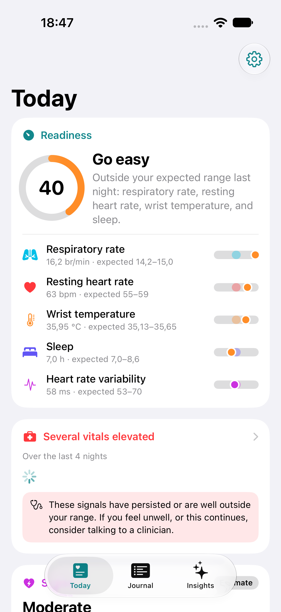
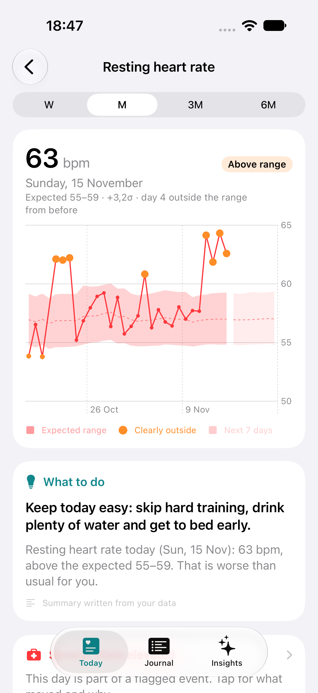
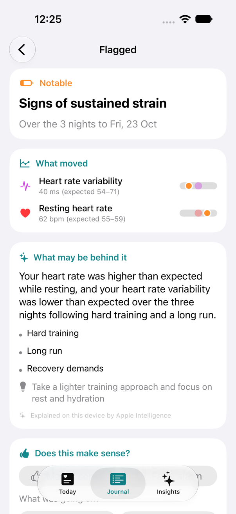
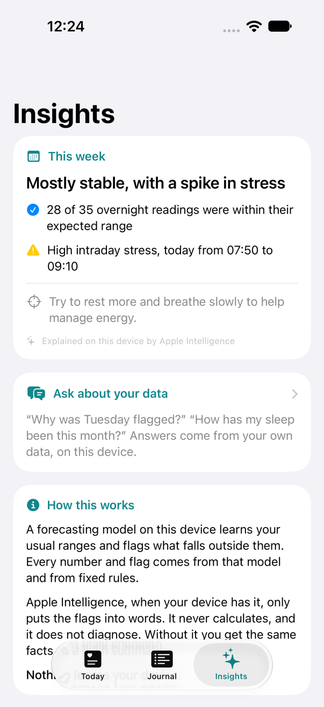

# Baseline

An iOS app that learns your usual ranges from Apple Health and notices when they shift.
Chronos-2-small runs on the device (Core ML) and forecasts each metric's expected range.
Fixed rules turn deviations into flags, and Apple Intelligence (Foundation Models) puts the
flags into words. Nothing leaves the device.

It is the on-device follow-up to the thesis in [chronos-health](https://github.com/NikolaJankovikj/chronos-health).
Wellness insights, not medical advice.

<p>
 
 

</p>

## How it works

```
HealthKit ──▶ daily series ──▶ Chronos-2 (Core ML) ──▶ expected range ──▶ scores, rules ──▶ flags
                                                                                            │
                         screen ◀── guard ◀── Apple Intelligence ◀── facts worded by code ◀─┘
                            ▲         └─ rejected ─▶ template
```

- **Forecaster.** `chronos-2-small` exported as one fixed-shape ML Program with int8
  weights, 28 MB. It matches PyTorch to within 2.5% of the q10–q90 band on golden fixtures,
  and a 32-row call takes about 55 ms on an M3 CPU ([`docs/coreml_parity.md`](docs/coreml_parity.md)).
- **Rules, not the model, decide.** The expected range is the forecast's q10–q90. Flags come
  from fixed rules over the standardised residual, and the language model only explains.
  Every output passes a guard (no new numbers, no diagnoses, no wrong side of a range) or is
  replaced by a template. That template is also what you see without Apple Intelligence.
- **Ask** is a chat about your own data with three agents: triage, research with lookup
  tools, and a writer that streams the answer.

**Takeaway:** as in the thesis, Chronos-2 is no more accurate than a 28-day average
(resting heart rate: 1.47 vs 1.47 bpm error). It earns its place with ranges from the first
days, missing nights handled without imputation, and one model for all eight metrics. The
small language model works best when code has already decided everything. Full write-up in
[`report/report.pdf`](report/report.pdf).

**Not yet run on an iPhone.** Everything is tested in the iOS 27.2 simulator and on macOS
(64 package tests and 12 app tests). The nightly background task, a real watch's data and
iOS 26 have not been tried.

## Run

Open `Baseline.xcodeproj` and run on a simulator; for an iPhone, set your team on the
Baseline target first. Choose *Explore with demo data*, or fill the simulator's empty Health
store via *Settings → Debug → Write demo data to Apple Health* and connect Apple Health.

```sh
scripts/swift.sh test                         # package tests on the Mac
scripts/apptest.sh                            # app and UI tests in the simulator
scripts/apptest.sh testAppleHealthRoundTrip   # one UI test
cd tools/coreml_export && uv run python export.py   # re-export the model and fixtures
```

The scripts use Xcode's toolchain even when `xcode-select` points at the Command Line Tools.
The live language-model tests are skipped where Apple Intelligence is off. A failing UI test
takes three minutes to report; its log is `.build/xcode/apptest.log`.
