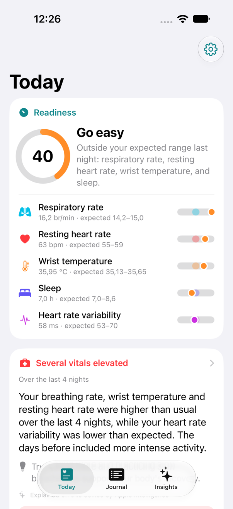
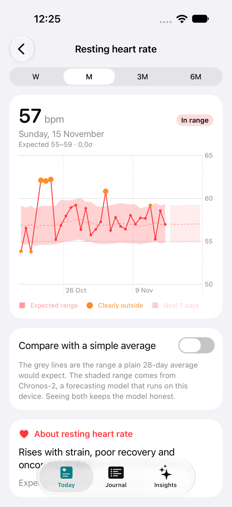
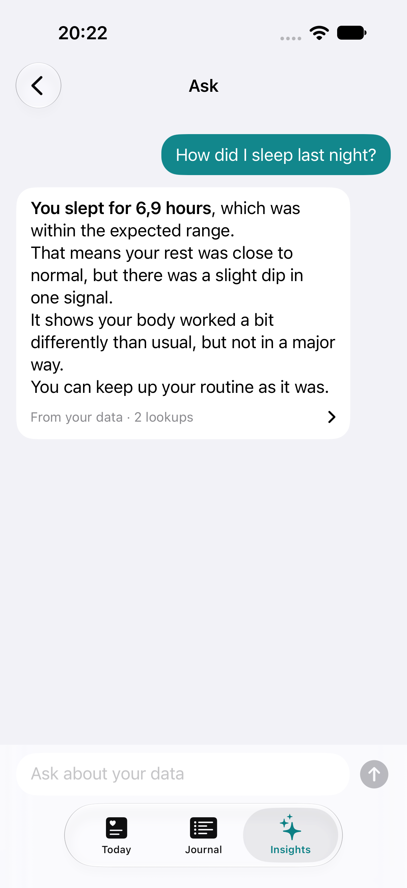

# Baseline

An iOS app that learns your usual ranges from Apple Health and notices when they shift.
Chronos-2-small runs on the device (Core ML) to forecast each metric's expected range;
fixed rules turn deviations into flags; Apple Intelligence (Foundation Models) puts the
flags into words. Nothing leaves the device.

It is the on-device follow-up to the thesis in `../chronos-health`. Wellness insights, not
medical advice.

<p>
 
 

</p>

## Status

Built with Xcode 27.2 and run in the iOS 27.2 simulator (iPhone 18 Pro). The screenshots are
taken there by the UI tests.

| | |
|---|---|
| App in the simulator | Builds from `Baseline.xcodeproj` and runs. 10 UI tests pass, covering every screen on demo data and both ways into Apple Health, and 2 tests of the app state. |
| Package `BaselineKit` (everything but the screens) | 55 tests pass on macOS, including the Core ML parity test and three that put nine cases to the live language model. |
| Core ML model | Matches PyTorch on the golden fixtures, from Python and from Swift. |
| Apple Health | A UI test writes the demo history into the simulator's Health store and the app reads it back through HealthKit: daily metrics, sleep, intraday heart rate. Wrist temperature and workouts cannot be written, so reading those is untested. |
| Apple Intelligence | Explanations, weekly report and Ask run against the real model, on macOS 27.2 and in the simulator. |
| Notifications | The permission prompt and the banner after a background update are covered by a UI test. |
| Nightly background task | **Never run.** The simulator does not schedule background tasks; a debug button in Settings runs the same update. |
| On an iPhone | **Never run.** Nothing here has been on a physical device, with a real watch's data, or on iOS 26 (the deployment target). |

## Run it

**In Xcode:** open `Baseline.xcodeproj` and run on a simulator. For an iPhone, set your team
on the Baseline target first. Pick *Explore with demo data* on the first screen, or *Connect
Apple Health*. The demo scenario is under Settings: sick week, healthy, first days. To start
in a scenario directly, add the launch arguments `-dataSource demo -scenario sickWeek`.

In the simulator Apple Health is empty. *Settings → Debug → Write demo data to Apple Health*
fills it; then switch the source to Apple Health.

On a simulator that has never used Health, the access sheet can take a minute to come up
after *Connect Apple Health*, or the request times out. The loading screen says so and
offers the demo data meanwhile; a request that fails later no longer changes what is on
screen, and the failure screen offers *Try again* and the demo data. The sheet may still
appear over the demo a minute later: either answer leaves the demo in place.

**From the command line:**

```sh
scripts/swift.sh test                         # the package's tests, on the Mac
scripts/apptest.sh                            # the app's tests in the simulator; screenshots in .build/xcode/screenshots
scripts/apptest.sh testAppleHealthRoundTrip   # one UI test
```

Both scripts use Xcode's toolchain even while `xcode-select` points at the Command Line
Tools. To make plain `swift` and `xcodebuild` do the same:
`sudo xcode-select -s /Applications/Xcode.app`.

The tests against the language model run only where Apple Intelligence is turned on and are
skipped elsewhere. A failing UI test takes three minutes to report: Xcode hangs while it
collects diagnostics, until the time allowance ends it. The steps up to the failure are in
`.build/xcode/apptest.log`.

## How it works

```
HealthKit ──▶ daily series ──▶ Chronos-2 (Core ML) ──▶ expected range per day ─┐
 (or synthetic)               simple 28-day average ─▶ comparison range        │
                                                                               ▼
                    readiness · flagged events · stress estimate   ◀── scoring and rules (Swift)
                                                                               │
                                        facts worded by code ──▶ Apple Intelligence ──▶ guard ──▶ screen
                                                               └─▶ template (no model, or guard said no)
```

| Where | What it owns |
|---|---|
| `App/` | The app target: app state (`AppModel`), all screens, background refresh, notifications, icon |
| `BaselineKit/` | A local Swift package with everything that is not a screen, in four modules: |
| · `HealthData` | `Metric`, the `HealthDataProvider` protocol, `HealthKitProvider`, `SyntheticProvider` with the scripted scenarios |
| · `Forecasting` | Core ML wrapper and batching, simple average, frozen ranges, readiness, event rules, stress estimate, backtest |
| · `Insights` | Facts for the model, templates, guided generation, the output guard, metric advice, Ask session |
| · `Persistence` | Journal (logs, feedback, explanations) and forecast cache as two JSON files; CSV export |
| `Config/` | Info.plist keys and entitlements |
| `AppTests/`, `UITests/` | Tests of the app state, hosted in the app, and UI tests; both run in the simulator |

The four modules stay a package because their tests then run on the Mac in half a minute,
without a simulator, where the forecasting model is about seven times slower. In Xcode the
package is listed under *Package Dependencies*; it is local and edited in place.

### The model

`tools/coreml_export/export.py` exports `autogluon/chronos-2-small` as one
fixed-shape ML Program: 32 rows × 512 context steps in, 13 quantile levels × 16 steps out.
Rows with the same group id attend to each other, so one call can hold many independent
series or a joint group with covariates. Shorter histories are left-padded with a mask, which
is exact. Details and measurements are in [`docs/coreml_parity.md`](docs/coreml_parity.md):

- int8 weights, 28 MB. Against the PyTorch pipeline the q10–q90 levels are off by at most
  2.5% of the band width on the fixtures (float32 weights: exact, 112 MB).
- About 55 ms per 32-row call natively on an M3 CPU, and about 410 ms in the iOS simulator
  on the same Mac. Not measured on an iPhone; Settings → Model check shows the time spent on
  the device. In the simulator Today appears after a few seconds and the rest of the six
  months fills in behind it; after that a refresh forecasts one new day.
- Float32, CPU only: instance normalisation overflows float16, and background tasks may not
  use the GPU.

To re-export: `cd tools/coreml_export && uv run python export.py`.
It rewrites the model, the fixtures and the parity report here.

### From forecast to flag

- **Expected range** = the forecast's q10–q90. **Score** = (observed − median) / σ̂ with
  σ̂ = (q90 − q10) / 2.5631, the thesis's standardized residual.
- **Frozen ranges.** A forecaster that sees a deviating night adapts and calls the next one
  normal. While values stay outside the range, the range stays the one forecast before the run
  began (multi-step ahead), for up to 7 nights; then the deviation is the new normal. This is
  the thesis's fixed personal reference, and it is what makes multi-night rules work.
- **Readiness** (0–100): a weighted logistic of last night's scores toward each signal's
  concerning side. A heuristic, not a clinical score.
- **Events:** several vitals above range on ≥ 2 nights; heart rate up and variability down on
  ≥ 3 nights; other deviations grouped per stretch of days; daytime stress episodes. A single
  mild night for one metric is not an event. Nothing is flagged before 14 nights of data.
- **"Consider talking to a clinician"** is set by a rule (4 nights, or one signal ≥ 5σ) and
  shown from that flag. The language model is told not to say it.
- **Stress estimate:** heart rate in 5-minute bins against the forecast given steps, with
  sleep, workouts and moving bins left out. Labelled as an estimate.

### The language model's job

It explains; it does not compute or decide. What that took in practice, from running it:

- All comparisons are worded by code ("64 bpm, above the expected 55–59"), and signals above
  and below their range are listed apart. Given bare numbers the model misjudged which side
  a value was on; given one mixed list it called everything "elevated".
- Outputs use guided generation (`@Generable`) and pass `InsightGuard` or are replaced by
  the template: no number that is not in the facts, no diagnosis or medication terms, no
  signal on the wrong side of its range, no "last night" or "yesterday" the facts do not say.
- In the weekly report the model writes only the headline and the focus. The lists of what
  went well and what was flagged are facts and come from code; left to choose, the model
  praised metrics that had got worse.
- Ask runs three agents. Triage sorts the message into a greeting, a question about the
  user's data, or something else; for the first and last the model writes a short reply and
  says it is not a general assistant. Research calls lookup tools (sleep, a metric, workouts,
  logs, flags), each shown in the chat as it is made; the summaries the question's words
  point to are always added, since the small model sometimes skips or mixes up tools. The
  writer streams the answer from those lookups in plain words. An answer that fails the
  guard gets one retry, told what was wrong; after that the lookups are shown. Answers
  carry their lookups ("From your data · 2 lookups").
- An out-of-range value on a metric's screen comes with "What to do": code decides whether
  it is the better or worse side and picks the advice; the model words it with the user's
  own context (logs, long workouts).
- Without Apple Intelligence every screen still works: templates explain events and give
  advice, and Ask answers with the summaries the question is about.

**The model changes under the app.** All of this was first tuned on macOS 26. The model in
iOS and macOS 27 ("AFM 3") then skipped the tools for about half the questions and answered
from nothing, fluently: "nothing was flagged this week" when something was. It took new
instructions (the model "knows nothing until it calls a tool"), the rule above, and day
labels worded by code to get correct answers again. The session also throws different error
types on 27. The live-model tests (`askAnswersEachQuestionWithinItsData` and others) are there to notice
the next such change; rerun the package tests after an OS update.

## Where this differs from the plan

- **Per-metric forecasting is the default; joint forecasting is a setting.** The thesis found
  covariates neutral at best. Settings → Model check backtests both against the simple average
  on your own history, so the question is answered by data rather than assumed.
- **Charts span W / M / 3M / 6M.** There is one value per day, so a single-day view is empty.
- **Stress uses 5-minute bins**, which is how often the watch samples heart rate at rest.
- **Wrist temperature is shown as the sleeping temperature itself.** Its expected range does
  the job of the "deviation from baseline".
- **Only alcohol logs are written to Apple Health.** Caffeine in Health is a dose in
  milligrams, which a one-tap log does not have.
- **The screens are in the app target, not a fifth package.** The plan suggested local
  packages for all five modules. The four without screens are one; the app's own code is
  where Xcode shows it as the app's.
- **JSON files instead of SwiftData.** The app stores two small documents, read and written
  whole: the journal and the forecast cache. SwiftData would add a schema and a context for
  no query the app makes. `Store` is the only type that would change.
- **Not built:** the BLE chest-strap mode and the Swift port of the RMSSD pipeline, a watchOS
  app, fine-tuning.

## What the thesis says about all this

The thesis (`../chronos-health/results`) found that forecast residuals detect lab stress
well (median AUROC ≈ 0.96 on WESAD), that Chronos-2 was **not better than a simple average**
for it, and that covariates did not help. The app is built to stay honest about that:

- The simple-average range is one toggle away on every chart, and the model check reports
  error and coverage for both. On the synthetic person they are about equal (resting heart
  rate in the simulator: 1.47 vs 1.47 bpm error, 77% vs 76% coverage; joint forecasting 1.46
  bpm), which is the thesis result again.
- What Chronos-2 adds here is not accuracy but ranges from the first days, missing values
  handled, multi-step horizons for the frozen ranges, and one model for every metric.
- The deviation score flags any departure from your normal. It cannot tell stress from
  illness from a late night; the event rules and your own logs narrow it down, and the app
  says "may".

## Limitations

- Evaluated on synthetic data only. The rules' thresholds (2σ, 2 nights, 14 nights, the
  readiness weights) are reasoned defaults, not fitted to real outcomes.
- HealthKit is tested with data the app wrote itself. What a real watch records is not:
  which day a resting-heart-rate sample lands on, how sparse HRV is, time-zone travel (event
  ids are tied to local midnights). On iOS 27 the Health sheet also lets the user share
  only the past 30 days; the app works with that, with less history to learn from.
- The on-device language model is small. The guard catches numbers, sides, day words and
  diagnosis terms; it cannot catch a vague or loosely rounded sentence ("about a third of
  the days"), which is why Ask shows its lookups next to the wording. The model also tends to
  append a general suggestion nobody asked for.
- English only.

## Privacy

HealthKit queries, forecasting and the language model all run on the device. The app has no
network code, account, analytics or third-party dependency. Its own files (journal, forecast
cache) sit in its container with file protection, and Settings can erase them or export the
daily values as CSV.
